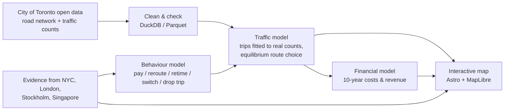

# Congestion Cordon

*Testing the case for congestion pricing in Toronto*

**Could congestion pricing work in Toronto, and if so where and how?** This is an open research and simulation tool built on the City of Toronto's own traffic data. It sits alongside what actually happened in New York, London, Stockholm and Singapore.

**▶ [View the presentation](https://congestion-cordon.andrew-girgis.workers.dev/present/)** · [Interactive site](https://congestion-cordon.andrew-girgis.workers.dev/)

> **Status: work in progress.** Built at a Toronto civic buildathon (October 2026). Sections marked *(planned)* are not built yet. Every number in the tool carries a label saying whether it was **observed**, **estimated** or **simulated**.

---

## The problem, in one minute

- Downtown Toronto's roads are congested, but **Toronto's open data has no count of how many vehicles enter downtown each day**. Its downtown cordon count covers **bicycles only**.
- Toronto has studied road tolls before. In 2015 the City modelled a $3 toll on the Gardiner and DVP ([Staff Report EX8.14](https://www.toronto.ca/legdocs/mmis/2015/ex/bgrd/backgroundfile-83671.pdf)). Since June 2025, Ontario law says the City "does not have the power" to toll a road, even to ease congestion. Any real scheme would need the Province to pass a law, and that would take strong evidence.
- Four cities have priced congestion, with different designs and different results. Their lessons are buried in reports.

**What this tool does:** it rebuilds a picture of downtown traffic from the City's open counts. It simulates how traffic, travel times and nearby neighbourhoods could change under different charge designs, and estimates costs and revenue over 10 years. Every result sits beside observed evidence from other cities.

**What it does not do:** assume pricing is good, or treat revenue as the goal. "This design would backfire" is a valid answer.

**The ask, in two steps:**
1. **Now:** the City's Transportation Services division runs a **90-day pilot** of this open tool on its internal data to test downtown charging options. This is low cost and within City authority.
2. **Then, only if the evidence holds up:** a staged path toward a time-limited pricing trial, like Stockholm's 2006 trial → referendum → permanent scheme. This needs provincial legislation, transit capacity in place before launch, and an agreed use for the revenue.

See [`adoption/`](adoption/) *(planned)*.

**Shaped by people we talked to.** Feedback gathered at the event changed what we built: an approach-direction view of who would pay (e.g. commuters from the west), tests of whether drivers would cut through neighbourhood streets, a lessons table of what went wrong elsewhere, and explicit growth assumptions. See [`research/user-feedback/`](research/user-feedback/).

---

## How it works



1. **Road network and counts.** Downloads Toronto's road centreline plus midblock and intersection traffic counts as dated snapshots, then cleans and checks them (year, season, direction, vehicle class, gaps).
2. **Baseline traffic model.** Trips across downtown plus about a 1.5 km buffer for a weekday morning (6–10 a.m.), fitted to the City's counts with SUMO's routeSampler. Street-level volumes and speeds come from an hourly equilibrium assignment (AequilibraE): trips that touch a charged road choose routes on time plus the charge, and all other trips keep their fitted routes. About 20% of count locations are held back as a test, and the fit is published (below target; see `docs/validation.md`). A SUMO vehicle simulation was tried first but gridlocked at expressway-ramp junctions.
3. **Behaviour.** When a charge is applied, affected trips are split into: keep driving and pay, take another route, leave at a different time, switch to transit/walk/bike, or combine/cancel the trip. The shares come from published evidence and are shown as low/base/high ranges. Only drivers who keep driving stay in the traffic model.
4. **Scenarios**, each compared with the *same* Toronto without pricing:
   - **S1:** $3 Gardiner/DVP toll, a partial check against the City's 2015 study.
   - **S2:** Downtown cordon plus Gardiner/DVP at about C$12.50 in the morning peak, matching New York's US$9.
   - **S3:** Same cordon with a time-varying rate: full price 7–9 a.m., half price in the shoulder hours.
   - **S4 (headline):** Downtown cordon only, New York-style. Through traffic uses the Gardiner/DVP free; exiting into downtown or crossing in on any street is charged. Added after user review, when charging the expressways (S2) pushed traffic onto neighbourhood streets.
   - The traffic response is anchored to New York (about −11% of entries), with Stockholm's −22% as the upper end. New transit trips and fares (TTC and GO) are estimated from the drivers the charge takes off the road.
5. **Money.** Gross collections are estimated from chargeable trips *after* people respond, times the rates, with exemptions, ride-hail treatment and collection losses applied. Startup costs, operating costs, transit service and fairness measures are shown separately over 10 years, in 2025 dollars. Toll revenue is never counted as a social benefit. The model shows that the more a charge cuts traffic, the less it may collect.
6. **Fairness.** Neighbourhood income and transit access around the zone, plus where the model says diverted traffic would go. Without trip-level data we can't say who would pay, and the tool says so.
7. **Other cities.** City-level panels of what was observed before and after, taken from official evaluations, plus New York charts from its open data. No case has open street-level data from before its launch, so we don't invent street-level history.

---

## Run it locally

Requirements: macOS or Linux, Python 3.14, [uv](https://docs.astral.sh/uv/), Node 24. No accounts or API keys are needed.

```bash
git clone <this repo> && cd toronto-congestion-project
uv sync            # Python dependencies (DuckDB, SUMO, geopandas, AequilibraE)
make data          # download dated snapshots of the open data
make sim           # build the road network, fit the baseline, run scenarios
make model         # behaviour + financial model
make web           # export map data
make check         # sanity tests
make serve         # demo at http://localhost:4321
make deploy        # publish to Cloudflare (after `npx wrangler login`)
```

The demo reads only precomputed files in `web/public/data/`, so it works offline.

---

## Repository structure

```
├── README.md            # you are here
├── AGENTS.md            # detailed guide for contributors and AI agents (rules, decisions, conventions)
├── CLAUDE.md            # points to AGENTS.md
├── data-sources.md      # original research notes (starting point, not verified; see docs/access-audit.md)
├── config/              # scenario settings and every modelling assumption, each with its source
├── data/                # raw dated snapshots (not committed) + manifest of sources, dates, checksums
├── src/cordon/  # Python pipeline: ingest → network → demand → behaviour → finance → export
├── sim/                 # network, fitted demand and model outputs (large files gitignored)
├── research/            # source register, research brief, city case studies, user feedback
├── adoption/            # who would run it, cost, data & privacy plan, 90-day pilot
├── docs/                # access audit, methodology, validation results, gaps and next steps
├── web/                 # Astro + MapLibre interactive site
└── tests/               # data checks and model sanity tests
```

---

## Data sources

All data used tonight is free and public, and none of it needs a login. Full access audit: [`docs/access-audit.md`](docs/access-audit.md).

### Toronto: [City of Toronto Open Data](https://open.toronto.ca)

| Dataset | Portal ID | Used for |
|---|---|---|
| Traffic Volumes: Midblock Vehicle Speed, Volume and Classification Counts | `traffic-volumes-midblock-vehicle-speed-volume-and-classification-counts` | Volumes, speeds, heavy vehicles at road segments |
| Traffic Volumes: Multimodal Intersection Turning Movement Counts | `traffic-volumes-at-intersections-for-all-modes` | Vehicles entering intersections by direction |
| Toronto Centreline (TCL) | `toronto-centreline-tcl` | Road network geometry |
| Neighbourhoods; Neighbourhood Profiles (2021) | `neighbourhoods`, `neighbourhood-profiles` | Fairness context (income, commuting) |
| Private Transportation Companies: summary and trip data | `private-transportation-companies-summary-and-trip-data` | Ride-hail share for revenue treatment |
| Bicycle and Micromobility Cordon Count | `bicycle-and-micromobility-cordon-count` | Reference for a downtown cordon definition |
| King Street Transit Pilot datasets | search "king" | Toronto's own before/after evaluation template |

Licence: Open Government Licence – Toronto (most datasets list "License not specified"; per-dataset terms being confirmed).

### New York: [data.ny.gov](https://data.ny.gov)

| Dataset | ID | Coverage |
|---|---|---|
| MTA Congestion Relief Zone Vehicle Entries | `t6yz-b64h` | From launch day, 2025-01-05 (no pre-launch rows) |
| MTA Daily Ridership and Traffic | `sayj-mze2` | Daily from 2020-03-01 |
| MTA Vehicle Miles Traveled in the CBD | `jbxx-kxff` | Monthly from 2024-01 |
| MTA CBD Bus Speeds | `r6db-kkzj` | Monthly from 2023-01 |
| MTA CBD Geofence | `srxy-5nxn` | Zone boundary |

### London, Stockholm, Singapore

- **London:** TfL Central London Congestion Charging Impacts Monitoring, [Second Annual Report (2004)](https://content.tfl.gov.uk/impacts-monitoring-report-2.pdf) and [Sixth Annual Report (2008)](https://content.tfl.gov.uk/central-london-congestion-charging-impacts-monitoring-sixth-annual-report.pdf). Also the [UK DfT road traffic statistics API](https://roadtraffic.dft.gov.uk/).
- **Stockholm:** Eliasson et al. (2009), *Transportation Research Part A* 43; Börjesson & Kristoffersson (2018), *Transportation Research Part A* 107; Transportstyrelsen congestion-tax statistics.
- **Singapore:** Phang & Toh (2004), *Journal of Transport Economics and Policy* 38(3); Olszewski (1999); data.gov.sg *Average Daily Traffic Volume Entering the City* (2004–2025). The 1975 Area Licensing Scheme and 1998 Electronic Road Pricing are treated as separate interventions.

The complete register with dates, units and limitations is in `research/sources.csv` *(planned)*.

### Basemap

[OpenFreeMap](https://openfreemap.org): OpenFreeMap © OpenMapTiles, data from © OpenStreetMap contributors.

---

## Built with

Python · [DuckDB](https://duckdb.org) (spatial) · [Eclipse SUMO](https://eclipse.dev/sumo/) · [AequilibraE](https://www.aequilibrae.com) · GeoPandas · [Astro](https://astro.build) · [MapLibre GL JS](https://maplibre.org) · [Observable Plot](https://observablehq.com/plot) · uv

## Limitations (read these)

- Toronto's counts are short-term and taken on different dates at different places. They are not a coordinated cordon count, and the tool shows where coverage is missing.
- There is no public trip-level origin–destination data, so the traffic model is fitted to counts, not to observed trips. Who pays, by home area, cannot be identified.
- Behavioural responses come from other cities and published research, so they are assumptions, shown as ranges.
- Modelled results are labelled **simulated**; they are scenarios, not predictions with statistical confidence intervals. The baseline is below the usual calibration target, so speed gains are likely understated and diversion likely overstated (`docs/validation.md`).

## Licence

Code and original documentation: [MIT](LICENSE).

Not covered by the MIT licence:
- **Data** stays under its publishers' licences (see [Data sources](#data-sources)).
- **Third-party images** in `web/public/present/media/` belong to their owners: the London zone map, the Metro Stockholm front page, and the Singapore ERP gantry photo by Streetdirectory.com. See `research/sources.csv` (IMG-001 to IMG-004). Their reuse terms are UNVERIFIED.
